# video-editor-ai

Automatic editing pipeline for technical tutorials, driven by a deterministic
`edit_plan.json` that is independent from the editor.

The plan is the source of truth: input ingestion, cuts, subtitles, picture-in-picture,
audio mastering, rendering and QC all read from it. Every natural-language edit
creates a new immutable revision instead of mutating the previous plan.

[Español](README.es.md) · [Pipeline notes](docs/scale.md) · [OpenChatCut spike](docs/spike-openchatcut.md)

## What it does

- Ingests screen, webcam/mobile and voice recordings with SHA-256 hashes and
  `ffprobe` metadata.
- Transcribes locally with `faster-whisper` (GPU by default, CPU fallback).
- Detects silences, filler words and repetitions; cuts that affect meaning require
  explicit human approval.
- Builds a validated `edit_plan.json`, applies JSON Patch revisions and keeps an
  immutable history.
- Aligns a mobile camera as picture-in-picture by audio correlation.
- Burns subtitles with an ASS file at the real output resolution.
- Renders locally with FFmpeg + NVENC, masters audio to −14 LUFS, and runs QC.
- Exports FCPXML for further editing.
- Exposes an MCP adapter for the OpenChatCut editor, bound to `127.0.0.1`.

## Pipeline

```mermaid
flowchart LR
  A[Screen / webcam / voice] --> B[Ingest + hash + ffprobe]
  B --> C[Local ASR: faster-whisper]
  C --> D[Plan builder + validator]
  D --> E[Immutable revision: JSON Patch]
  E --> F[Cuts + subtitles + PiP]
  F --> G[FFmpeg NVENC render]
  G --> H[Audio master -14 LUFS]
  H --> I[QC: duration, true peak, LUFS, frames]
  I --> J[FCPXML / final master]
```



The editor (OpenChatCut) is optional for interactive work. The deterministic
renderer is the path used for the final master.

## Measured throughput

On a 30-minute, 1080p tutorial recording:

| Stage | Result |
|---|---|
| Full pipeline (ASR + NVENC render + master + QC) | **~7.6 min** |
| Peak memory | **2.5 GB** |
| ASR throughput | RTF **0.105** (120 s audio in 12.6 s) |
| Warm-cache ASR | 13.9 s audio in 0.65 s (RTF ~0.05) |
| QC | OK: 1800.09 s, true peak −1.0 dBFS, −16.6 LUFS |

Hardware: RTX 3050 Ti (4 GB, NVENC), 16 GB RAM class laptop. These are local
measurements, not a guarantee for other hardware. Methodology and per-stage
numbers: [`docs/BENCHMARKS.md`](docs/BENCHMARKS.md).

## Quick start

```bash
python3.12 -m venv .venv
. .venv/bin/activate
pip install -e '.[asr,vision,providers]'

PYTHONPATH=src python scripts/run_project.py \
  --screen screen.mkv --webcam phone.mp4 --voice voice.wav \
  --out-dir data/my-tutorial --project-name "My tutorial"
```

Optional OpenChatCut integration:

```bash
./scripts/run-openchatcut.sh          # local server on 127.0.0.1:5199
python3 scripts/occ_spike.py          # exercise the MCP flow
python3 scripts/occ_export.py <id> data/artifacts/out.mp4
```

Inspect the plan and apply a revision:

```bash
PYTHONPATH=src python -m video_ai.cli show data/my-tutorial
PYTHONPATH=src python -m video_ai.cli apply data/my-tutorial "remove silences"
```

## Project layout

```text
config/       provider, editor and privacy configuration
schemas/      versioned edit-plan schema
src/          ingestion, audio, vision, planning, adapters, QC
scripts/      startup, MCP spike and headless export helpers
tests/        fixtures and test protocol
docs/         architecture, ADRs and benchmark notes
data/         local projects and artifacts (git-ignored)
vendor/       third-party binaries and source (git-ignored)
```

Each video lives in its own folder under `data/projects/`; inputs and outputs are
never committed.

## Tests

```bash
.venv/bin/python -m pytest -q
```

The suite covers plan validation, JSON Patch revisions, cut compilation, subtitle
timeline mapping, PiP transforms, audio alignment, QC thresholds, command parsing
and the OpenChatCut adapter contracts. Hardware-dependent tests are skipped when
the required GPU, model or media fixture is absent.

## How it was built

The repository is developed with an AI-assisted workflow:

- `AGENTS.md` is the contract for coding agents: invariants, honesty rules and
  verification requirements.
- `docs/` contains ADRs, spike reports and operating guides.
- Tests and real renders are the acceptance gate; a test that only starts the app
  is not considered a pass.
- Every revision is inspectable and immutable; the human reviews the diff and the
  final QC before accepting a change.
- AI tools used include OpenCode, Claude Code and Gemini API.

## Demo

[](https://youtu.be/XcZ60adpBms)

A Peresotech demo produced with this pipeline (8:01): screen + mobile PiP, silence cuts, subtitles, audio master and QC. Synthetic data; no real systems are connected.

A before/after video of the editing process is not included; the demo above is a real output produced with the pipeline. No mock video is shipped in place of a real render.

## Limits

- The pipeline is deterministic but opinionated: it is designed for technical
  tutorials, not narrative film editing.
- ASR quality depends on the model, language and audio; filler detection is
  conservative and meaning-changing cuts require approval.
- OpenChatCut is an external AGPL-3.0 component; it is not bundled. The local
  renderer uses FFmpeg/NVENC and is independent of it.
- NVENC requires a compatible NVIDIA GPU; CPU rendering is possible but slower.
- The plan schema covers the operations implemented today; unsupported requests
  are rejected instead of simulated.

## License

MIT. See [`LICENSE`](LICENSE) and [`THIRD-PARTY.md`](THIRD-PARTY.md).

OpenChatCut, FFmpeg, faster-whisper, Remotion and other external components keep
their own licenses. Remotion and the example motion-graphics project are not
included in this repository.
